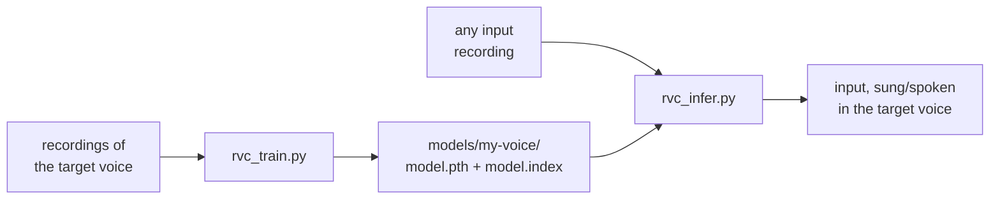

# rvc-lean

Command-line voice conversion with **RVC** (Retrieval-based Voice Conversion).
You train a model on recordings of one voice, then use it to make any other
recording sound like that voice. The words, melody and timing of the input are
kept; the timbre (the "colour" of the voice) is replaced.

This is a lean, command-line-only version of the
[RVC project](https://github.com/RVC-Project/Retrieval-based-Voice-Conversion),
made for running on a GPU cluster: no GUI, two scripts, one JSON file of
settings per run, and clear error messages.



## Quickstart

On a Linux machine with an NVIDIA GPU, Python 3.8 and `ffmpeg`
([details](docs/install.md)):

```bash
git clone https://github.com/BSCCNS/rvc-lean.git && cd rvc-lean

# 1. environment + pretrained models (~3.5 GB download), then a check
tools/setup_env.sh python3.8
source .venv/bin/activate

# 2. train a model on a folder of recordings
mkdir -p data params
cp params/example_train.json params/train.json      # edit exp_name and trainset_dir
python rvc_train.py params/train.json

# 3. convert a recording with it
cp params/example_infer.json params/infer.json      # edit model and input
python rvc_infer.py params/infer.json
```

Both scripts accept `--check`, which validates the params file and shows what
would happen without running anything.

## Documentation

| Page | What it covers |
|---|---|
| [docs/concepts.md](docs/concepts.md) | How RVC works: content, pitch, synthesizer, index, what training learns |
| [docs/install.md](docs/install.md) | Requirements, setting up the environment, checking it |
| [docs/training.md](docs/training.md) | Preparing data, every training parameter, what each stage does, resuming |
| [docs/inference.md](docs/inference.md) | Converting audio, what each setting sounds like, reproducibility |
| [docs/latent.md](docs/latent.md) | Exploring ContentVec's latent space: features per frame, phone labels, UMAP projection |
| [docs/cluster.md](docs/cluster.md) | Running on a SLURM cluster: setup, batch jobs, interactive sessions, storage |
| [docs/troubleshooting.md](docs/troubleshooting.md) | Error messages and what to do, and what to try when the result sounds wrong |

## Repository layout

```
rvc_train.py            train a voice model           (python rvc_train.py params.json)
rvc_infer.py            convert audio with a model    (python rvc_infer.py params.json)
rvc_latent.py           explore the ContentVec latent space (python rvc_latent.py params.json)
params/                 example params files, with the workshop values (example_train/infer/latent.json)
slurm/                  job scripts for the workshop cluster: sbatch slurm/train.sbatch (or infer, latent)
tools/
  setup_env.sh          create the Python environment and download the models
  check_env.py          check that the environment works (packages, GPU, ffmpeg, models)
  download_models.py    download the 4 pretrained models into assets/
  link_assets.sh        link the pretrained models from an existing assets/ folder instead
  compare_audio.py      compare two converted files objectively
  compare_training_data.py  compare two experiments' training data (e.g. from two machines)
  prepare_gtsinger.py   build the workshop training set from the GTSinger dataset
infer/                  the RVC code used by the two scripts
assets/                 pretrained models (downloaded, not in git) and small training files
requirements.in/.txt    Python dependencies (direct / fully pinned)
```

Folders you create while working (all ignored by git):

```
data/        your datasets and input recordings
params/      your JSON params files (next to the examples, which are in git)
models/      trained models: models/<exp_name>/  (created by rvc_train.py)
outputs/     converted audio                      (created by rvc_infer.py)
latent/      latent-space analyses: latent/<name>/ (created by rvc_latent.py)
```

## License

MIT, as the original RVC project: see [LICENSE](LICENSE) and the third-party
notices in [LICENSE-third-party-zh](LICENSE-third-party-zh).
