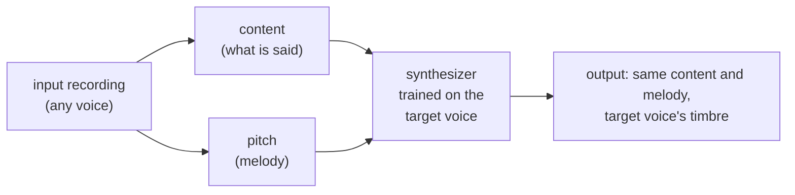
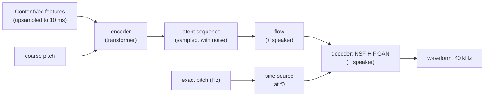
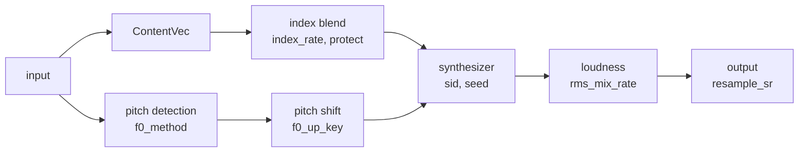

# How RVC works

This page explains what happens inside RVC (Retrieval-based Voice Conversion):
what each model does, why the voice changes but the words don't, what training
actually learns, and what the settings act on. It assumes some machine
learning background, and no audio background. Audio terms are explained
where they first appear, and collected in the [glossary](#glossary).

## Contents

- [The idea: separate *what* from *who*](#the-idea-separate-what-from-who)
- [Sound as data](#sound-as-data)
- [The three ingredients](#the-three-ingredients)
- [The synthesizer](#the-synthesizer)
- [The index: retrieval](#the-index-retrieval)
- [What training learns](#what-training-learns)
- [Where the settings act](#where-the-settings-act)
- [The pretrained files](#the-pretrained-files)
- [Glossary](#glossary)
- [Further reading](#further-reading)

## The idea: separate *what* from *who*

A recording of a voice mixes several things:

- **what** is said or sung: the words, the phonemes;
- **how it is pitched**: the melody, the intonation;
- **who** says it: the timbre, the "colour" that makes a voice recognisable.

RVC pulls the first two out of the input recording, throws away the third,
and lets a model trained on the target voice put a new *who* back in:



Everything else on this page is detail on how each arrow works.

## Sound as data

A recording is a sequence of numbers: the air pressure measured many times per
second. The **sample rate** is how many times: 16 000 per second (16 kHz) is
enough for speech analysis, 40 kHz is what RVC outputs (CD quality is 44.1 kHz).
Ten seconds at 40 kHz are 400 000 numbers: far too many to model one by one.

So the models work on **frames**: short overlapping windows, here every 10 ms
(100 frames per second) or 20 ms. For each frame, something is computed: a
pitch value, a feature vector, a **spectrum** (how much energy there is at
each frequency). A sequence of spectra over time is a **spectrogram**, the
"image" of a sound; a **mel spectrogram** spaces the frequencies the way human
hearing does. Many audio models, RVC included, measure their errors on mel
spectrograms.

## The three ingredients

### 1. Content: ContentVec features

**HuBERT** is a transformer trained by self-supervision on large amounts of
speech (no transcripts): it learned to predict hidden parts of speech from
their context, and in doing so learned representations of speech sounds.
**ContentVec** is a HuBERT model trained with additional objectives that
remove information about the speaker from those representations. RVC uses
ContentVec: it feeds it the input at 16 kHz and takes the output of its 12th
(last) layer: one **768-dimensional vector every 20 ms**, describing what is
being said at that moment.

These vectors carry mostly *content* and much less *speaker identity*: the
same phoneme spoken by two people gives similar vectors. That is what makes
voice conversion possible. "Mostly" matters, though: some of the input
speaker's characteristics leak through. That leak is what the
[index](#the-index-retrieval) addresses.

> **About the file name.** RVC distributes this model as `hubert_base.pt`,
> and the code calls it "hubert" throughout, but it is ContentVec: it
> contains the same network weights as the official **ContentVec_legacy
> (500 classes)** checkpoint, `checkpoint_best_legacy_500.pt`, published by
> the ContentVec authors. This was verified for this repository by comparing
> the two checkpoints tensor by tensor.

### 2. Pitch: f0 with RMVPE

**Pitch** is how high or low a voice sounds: the note being sung, or the
melody of a spoken sentence. Physically it is the **fundamental frequency, f0**,
the rate at which the vocal folds vibrate (roughly 80–250 Hz for speech, wider
for singing). Sounds without vocal-fold vibration (*s*, *f*, whispers,
breaths) have no pitch: they are **unvoiced**, and their f0 is 0.

**RMVPE** is a neural network that estimates f0 every 10 ms, and is robust to
noise and accompaniment. The pitch curve is passed to the synthesizer in two
forms: as exact frequencies, and as one of 255 coarse bins (a learned
embedding, like a vocabulary of notes).

Pitch shifting (`f0_up_key`) happens here, by multiplying the curve:
**12 semitones = one octave = double the frequency**, so `+12` multiplies f0
by 2 and `+1` by 2^(1/12) ≈ 1.06.

### 3. Timbre: the speaker embedding

The synthesizer is also given a learned **speaker embedding**, a 256-dimensional
vector representing *who*. The pretrained model has 109 of these (it was trained
on many speakers). When you train, the model is adapted to your voice under
speaker id 0. This is why `sid` should stay 0.

## The synthesizer

The synthesizer turns content + pitch + speaker into a waveform. It is based
on **VITS**, a text-to-speech architecture, with the text replaced by ContentVec
features:



- The **encoder** reads the content features and the coarse pitch and produces
  a distribution (mean and spread) for a latent representation, frame by
  frame. A sample is drawn from it, with a little noise: one reason why two
  runs differ slightly unless the [seed is fixed](inference.md#reproducibility).
- The **flow** (an invertible network) transforms that latent into the space
  the decoder expects, conditioned on the speaker embedding.
- The **decoder** is a **HiFi-GAN** vocoder: a convolutional network that
  upsamples the 100-frames-per-second representation 400 times, to 40 000
  samples per second. It is an **NSF** (neural source-filter) decoder: it is
  also fed a sine wave oscillating at the exact pitch, so the output follows
  the requested melody precisely instead of having to invent periodicity.

## The index: retrieval

The *R* in RVC. During training, all the ContentVec feature vectors of the
training data are stored in a **FAISS index**, a data structure for finding
nearest neighbours among hundreds of thousands of vectors quickly
(`model.index`).

At conversion time, with `index_rate` above 0, each input feature vector is
replaced, in part, by a weighted average of its **8 nearest neighbours** in the
training data:

```
feature = index_rate × (average of nearest training features) + (1 − index_rate) × input feature
```

The neighbours are real moments of the target voice saying a similar sound.
Using them reduces the input speaker's characteristics that leaked through
ContentVec, so the result sounds more like the target, including their accent
and articulation. The cost: if the training data does not contain a good
match (a different language, an unusual sound), the "nearest" neighbour can be
a different sound, which blurs words or adds artefacts.

`protect` limits this replacement during unvoiced frames (consonants, breaths),
where errors are most audible. That is also why `protect` does nothing when
the index is off.

## What training learns

Training is **fine-tuning**: the synthesizer starts from the pretrained
weights (`f0G40k.pth`), which already know how to produce speech in general,
and adapts to your recordings. ContentVec and RMVPE are not trained at all: they
are used as fixed feature extractors. That is why minutes of audio and a few
minutes of GPU time are enough.

During training, the model sees short random slices (0.32 s) of the training
segments, and must reconstruct the real audio from its ContentVec features and
pitch. Training uses an extra component that is thrown away afterwards: an
encoder that sees the *real* audio's spectrogram and tells the synthesizer
what the latent should be. The losses (shown in the [training log](training.md#following-the-training)):

| Loss | Measures |
|---|---|
| `loss_mel` | difference between the mel spectrograms of the generated and real audio (weighted ×45: the main signal) |
| `loss_kl` | how well the encoder's latent from features matches the one from real audio |
| `loss_gen`, `loss_disc` | the **GAN** game: a **discriminator** (`f0D40k.pth` is its starting point) learns to tell real audio from generated; the generator learns to fool it. This is what makes the audio sound natural rather than muffled |
| `loss_fm` | feature matching: the generated audio should produce similar internal activations in the discriminator as real audio |

After training, `model.pth` contains only what conversion needs: the encoder,
flow, decoder and speaker embeddings, stored in half precision (~55 MB).

## Where the settings act



| Setting | Acts on |
|---|---|
| `f0_method` | which pitch detector extracts the melody |
| `f0_up_key` | the pitch curve, before synthesis |
| `index_rate` | how much the content features are pulled towards the training data |
| `protect` | limits that pull in unvoiced frames |
| `sid` | which speaker embedding is used |
| `seed` | the random noise in the synthesizer |
| `rms_mix_rate` | the loudness contour of the result (input's vs model's) |
| `resample_sr` | the output sample rate |

## The pretrained files

| File | What it is | Used in |
|---|---|---|
| `hubert_base.pt` | the ContentVec content encoder (ContentVec_legacy, 500 classes) | training (features stage) and inference |
| `rmvpe.pt` | the RMVPE pitch estimator | training (f0 stage) and inference |
| `f0G40k.pth` | the pretrained synthesizer (generator), 40 kHz, with pitch | starting point of training |
| `f0D40k.pth` | the pretrained discriminator | starting point of training (not needed for inference) |

Long inputs are processed in chunks of about a minute, cut at quiet moments,
so memory use does not grow with the length of the input.

## Glossary

| Term | Meaning |
|---|---|
| **sample rate** | how many numbers per second describe the sound wave (16 kHz, 40 kHz) |
| **frame** | a short window of audio (10–20 ms here) described by one vector or value |
| **spectrogram** | energy at each frequency over time: the "image" of a sound; **mel** spectrograms use a hearing-like frequency scale |
| **pitch, f0** | how high a voice sounds; the fundamental frequency in Hz |
| **semitone** | the smallest step on a piano; 12 semitones = one octave = double the frequency |
| **cent** | 1/100 of a semitone |
| **voiced / unvoiced** | sounds with / without vocal-fold vibration (and therefore with / without pitch) |
| **timbre** | what makes two voices singing the same note sound different |
| **vocoder** | a model that turns a compact representation into an audio waveform |
| **epoch** | one pass of training over all the training data |
| **checkpoint** | the model's weights saved at some point during training |
| **fp16** | half-precision arithmetic: faster on modern GPUs, used automatically when supported |

## Further reading

- RVC: [RVC-Project/Retrieval-based-Voice-Conversion](https://github.com/RVC-Project/Retrieval-based-Voice-Conversion)
- HuBERT: Hsu et al., *HuBERT: Self-Supervised Speech Representation Learning by Masked Prediction of Hidden Units* (2021)
- ContentVec: Qian et al., *ContentVec: An Improved Self-Supervised Speech Representation by Disentangling Speakers* (2022)
- VITS: Kim et al., *Conditional Variational Autoencoder with Adversarial Learning for End-to-End Text-to-Speech* (2021)
- HiFi-GAN: Kong et al., *HiFi-GAN: Generative Adversarial Networks for Efficient and High Fidelity Speech Synthesis* (2020)
- RMVPE: Wei et al., *RMVPE: A Robust Model for Vocal Pitch Estimation in Polyphonic Music* (2023)
- FAISS: Johnson et al., *Billion-scale similarity search with GPUs* (2017)
