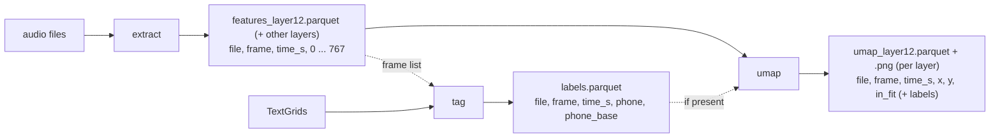

# Exploring the latent space

RVC converts voices through ContentVec features: one 768-dimensional vector
every 20 ms describing *what* is being sung or said ([concepts.md](concepts.md#1-content-contentvec-features)).
`rvc_latent.py` extracts these vectors for a set of recordings (from layer 12,
the one RVC uses, and optionally other layers), labels each one with the phone
being sung at that moment, and projects them to 2D with UMAP, so you can see
how the model organises speech sounds.

```bash
python rvc_latent.py params/latent.json --check   # validate and show the plan
python rvc_latent.py params/latent.json           # run
```

## Contents

- [The three stages](#the-three-stages)
- [A first run](#a-first-run)
- [Data without annotations](#data-without-annotations)
- [The params file](#the-params-file)
- [The outputs](#the-outputs)
- [Working with the results in Python](#working-with-the-results-in-python)
- [Other layers](#other-layers)
- [How the projection is made](#how-the-projection-is-made)
- [Randomness in UMAP](#randomness-in-umap)
- [Frames and time](#frames-and-time)
- [Re-running stages](#re-running-stages)
- [How long it takes](#how-long-it-takes)

## The three stages



| Stage | Does | Needs |
|---|---|---|
| **extract** | ContentVec features of the chosen layers (default: layer 12, the one RVC uses) for every 20 ms frame of every file | `audio_dir` |
| **tag** | the phone label of every frame, from Praat TextGrid annotations | `textgrid_dir`, the extracted features |
| **umap** | for each layer: a 2D projection of the frames, a table with the coordinates (and labels, if tagged) and a plot | the extracted features |

Each stage can be switched on or off in the params file. A stage that is off
reuses what an earlier run produced, so you can, for example, extract once and
try many UMAP settings.

## A first run

With the [workshop dataset](training.md#the-workshop-dataset), which comes with
TextGrid annotations:

```json
{
  "name": "en-alto-1",
  "audio_dir": "data/en-alto-1/wav",
  "textgrid_dir": "data/en-alto-1/TextGrid"
}
```

```
Analysis:   en-alto-1
Stages:     extract, tag, umap
Audio:      /path/to/data/en-alto-1/wav (342 files)
TextGrids:  /path/to/data/en-alto-1/TextGrid (tier "phone")
UMAP:       n_neighbors 100, min_dist 0.1, cosine, seed 42
Output:     /path/to/latent/en-alto-1

===== extract =====================================================
----- extract done in 0:04:58: 342 files, 54.2 min -> 162247 frames

===== tag =========================================================
----- tag done in 0:00:01: 162247 frames, 41 phone labels

===== umap ========================================================
  UMAP: fit on 162247 frames, project 162247 frames x 768 dimensions (of 162247; 0 not used to fit: none)
----- umap done in 0:03:32: 162247 frames -> umap_layer12.parquet, umap_layer12.png
```

`latent/en-alto-1/umap_layer12.png` is a first look, coloured by phone group:
vowels, consonants, silence (`<SP>`) and breath (`<AP>`).

## Data without annotations

Any folder of recordings works: set `"tag": false` and leave out
`textgrid_dir`. Extraction and projection run as usual; the projection has no
labels and the plot has a single colour.

```json
{"name": "my-recordings", "audio_dir": "data/my-recordings", "tag": false}
```

## The params file

[`params/example_latent.json`](../params/example_latent.json) lists every key
with the values used in the workshop; `python rvc_latent.py -h` prints this
table, with the defaults. Unknown keys and invalid values stop the run with a
message saying what is wrong, before anything is computed.

| Key | Default | Meaning |
|---|---|---|
| `name` | *required* | name of this analysis; outputs go to `<output_dir>/<name>/` |
| `audio_dir` | `null` | folder of audio files (needed by extract) |
| `textgrid_dir` | `null` | folder of TextGrids named like the audio files (needed by tag) |
| `output_dir` | `"latent"` | where the `<name>` folder is created |
| `layers` | `[12]` | ContentVec layers to extract and project, 1–12, e.g. `[8, 12]` ([below](#other-layers)) |
| `extract`, `tag`, `umap` | `true` | which stages run |
| `textgrid_tier` | `"phone"` | the TextGrid tier with the phone labels |
| `umap_n_neighbors` | `100` | how many neighbours UMAP considers: small values show local detail, large values the global layout. 100 is the value of the earlier Applio_LS analyses |
| `umap_min_dist` | `0.1` | how tightly points are packed in the plot, 0–1 |
| `umap_metric` | `"cosine"` | how distances between feature vectors are measured |
| `umap_max_files` | `null` | project only N randomly chosen files (`null` = all) |
| `umap_max_frames` | `null` | project a random sample of at most N frames (`null` = all) |
| `umap_frames_per_file` | `null` | at most N random frames per file (`null` = all) |
| `umap_exclude_phones` | `[]` | phone labels not used to **fit** UMAP, e.g. `["<SP>"]` (needs labels). Their frames are still projected (see [below](#how-the-projection-is-made)). Labels must match exactly: `"SP"` does not match `<SP>` |
| `seed` | `42` | random seed for sampling and UMAP: the same seed gives the same plot. `null` is faster (UMAP then uses several CPU cores) but not repeatable; a sample is then drawn at random, the same for every layer, and its seed is saved in `params.json` (`sample_seed`) |
| `overwrite` | `false` | replace the outputs of the stages that run |

## The outputs

```
latent/en-alto-1/
├── features_layer12.parquet   file, frame, time_s, 0 ... 767     (one row per frame, one file per layer)
├── labels.parquet             file, frame, time_s, phone, phone_base
├── umap_layer12.parquet       file, frame, time_s, x, y, in_fit, phone, phone_base   (one per layer)
├── umap_layer12.png           quick-look plot                                (one per layer)
└── params.json                settings, environment and summary of every run
```

- **file**: the audio file name without extension; **frame**: the frame
  number within the file, from 0; **time_s**: the time the frame represents
  (see [Frames and time](#frames-and-time)).
- **phone**: the label in the TextGrid, e.g. `AY1`, `<SP>`; **phone_base**:
  without the stress digit, e.g. `AY`. The GTSinger annotations use
  [ARPAbet](https://en.wikipedia.org/wiki/ARPABET) phones, plus `<SP>`
  (silence) and `<AP>` (breath).
- All tables share the keys `file, frame, time_s`, and every layer's features
  file has exactly the same frames, so one `labels.parquet` serves all layers.
- `params.json` lists, for every run, the settings, the code version, the
  environment and what each stage did: files and frames processed, files that
  failed, TextGrids that were missing or whose length did not match the audio.

## Working with the results in Python

```python
import pandas as pd

feats = pd.read_parquet("latent/en-alto-1/features_layer12.parquet")
labels = pd.read_parquet("latent/en-alto-1/labels.parquet")
df = feats.merge(labels, on=["file", "frame", "time_s"])   # vectors + labels

vectors = df[[str(i) for i in range(768)]].to_numpy()      # (frames, 768)
vowel_a = df[df.phone_base == "AA"]                         # all frames of one phone

# only some columns (fast, without loading the 768 values per frame):
frames = pd.read_parquet("latent/en-alto-1/features_layer12.parquet", columns=["file", "frame", "time_s"])

# the projection already includes the labels:
umap = pd.read_parquet("latent/en-alto-1/umap_layer12.parquet")
umap.plot.scatter(x="x", y="y", s=1)
```

## Other layers

ContentVec has 12 transformer layers; RVC uses the output of the last one.
`"layers": [8, 12]` extracts layer 8 as well, to compare how the
representation changes through the network. **Layer *k*** is the output of the
*k*-th transformer layer; in Hugging Face `transformers` terms, `hidden_states[k]`.

All requested layers come from **one** pass through the model (the outputs of
the requested layers are recorded on the way), so extracting two layers takes
about as long as extracting one. Each extra layer adds a features file (about
500 MB for the workshop dataset) and a UMAP run (about 3.5 minutes).

Features computed with other tools from the same model weights (e.g. through
Hugging Face `transformers`) are very close but not bit-identical: small
numerical differences between implementations, and above all differences in
how the audio is resampled to 16 kHz, carry through every layer.

## How the projection is made

The UMAP stage works as the earlier Applio_LS analyses did:

1. **Select** the frames to project (all, or a sample with `umap_max_files`,
   `umap_frames_per_file`, `umap_max_frames`).
2. **Fit** UMAP on the selected frames whose phone is *not* in
   `umap_exclude_phones` (by default, all of them).
3. **Project** all selected frames with the fitted model, including the
   excluded ones.

The output's `in_fit` column says which frames were used to fit. Excluding
noisy frames such as silence (`["<SP>"]`) keeps them from shaping the map,
while they still get a position on it. All coordinates come from projecting
with the fitted model (UMAP's `transform`), also for the frames used to fit.

## Randomness in UMAP

UMAP is a randomized algorithm: it starts from a random layout and improves it
step by step. Two runs on the same frames therefore give different pictures,
unless they use the same `seed`.

- **What changes between runs:** the layout as a whole. It can come out
  rotated or mirrored, and clusters can sit in other places. The x and y axes
  have no meaning, and neither do absolute positions or distances between
  clusters that are far apart.
- **What should stay:** which frames end up close together. The clusters and
  the neighbourhoods are the result; if a structure appears only in some runs,
  don't build conclusions on it.
- **`"seed": null`** (the workshop example) runs UMAP on all CPU cores: about
  1 minute per layer for all 162 000 frames on the workshop cluster. Run it
  twice and compare the plots to see what is stable.
- **A fixed seed** (the default, `42`) gives exactly the same projection every
  time, for figures and comparisons you need to repeat. UMAP then runs on a
  single core, several times slower (about 6 minutes per layer).

With a sample (`umap_max_files` and similar) and `"seed": null`, the sample is
drawn at random too: the same frames for every layer of a run, and its seed is
saved in `params.json` (`sample_seed`).

## Frames and time

ContentVec produces one vector every **20 ms**, but each vector is computed
from a **25 ms** window of audio: frame *i* covers 20·*i* to 20·*i* + 25 ms, so
neighbouring windows overlap by 5 ms. `time_s` is the **centre** of that
window, 20·*i* + 12.5 ms, and the label of a frame is the phone sounding at that
instant. Frames on the boundary between two phones get the one sounding at
their centre.

Two things to keep in mind when comparing vectors:

- **Context matters.** ContentVec's upper layers look at the whole input, so
  the vector for a moment also depends on the audio around it: the same
  recording processed on its own or as part of a longer file gives noticeably
  different vectors. `rvc_latent.py` processes every file separately; compare
  recordings that were processed in pieces of similar length. Files longer than
  60 s are processed in 30 s pieces.
- **Precision and audio.** Extraction runs in full precision (fp32), on the
  audio as decoded at 16 kHz, without the filtering RVC applies before
  converting. The vectors are therefore very close to, but not identical
  with, those RVC computes internally.

## Re-running stages

- Running the same params again stops with "already exists": set
  `"overwrite": true` to replace the outputs of the stages that run.
- **Only UMAP** (new settings, a subset): `"extract": false, "tag": false,
  "overwrite": true`. The features and labels are reused.
- **Only the labels** (another tier, corrected annotations): `"extract": false,
  "umap": false, "overwrite": true`. Re-run the UMAP stage afterwards if you
  want the new labels in the projection.
- **Re-extracting** replaces the frames, so labels and projections from before
  would no longer match: run the other stages too, or delete their files.

## How long it takes

Measured on the workshop dataset (342 files, 54 minutes, 162 000 frames), all
frames projected:

| Stage | Workshop cluster (H100, 20 CPUs) | Apple M-series laptop (GPU via MPS) | Grows with |
|---|---|---|---|
| extract | 45 s for 2 layers | 5 min | amount of audio; about the same for several layers |
| tag | 1 s | seconds | number of frames |
| umap, `"seed": null` | 1.3 min per layer | | number of frames projected (CPU only) |
| umap, fixed seed | 6 min per layer | 3.5 min per layer, 2.6 GB of memory | number of frames projected (CPU only, one core) |

The workshop example (layers 10 and 12, `"seed": null`) takes about 3.5 minutes
in total on the workshop cluster.

The features of 54 minutes of audio take about 500 MB per layer. To explore quickly,
project a sample with `umap_max_files`, `umap_frames_per_file` or
`umap_max_frames`: 50 of the 342 files (about 24 000 frames) take about
1 minute per layer with a fixed seed on the workshop cluster, 20 seconds
without.
