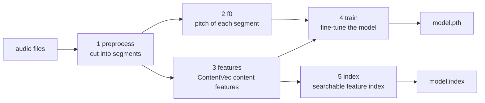

# Training a voice model

Training takes a folder of recordings of **one voice** and produces a model
that can make other recordings sound like that voice. It does not start from
zero: it fine-tunes a pretrained RVC model, so a useful model needs minutes of
audio and minutes to hours of GPU time, not days.

```bash
python rvc_train.py params/train.json --check   # validate and show the plan
python rvc_train.py params/train.json           # run
```

Everything for one experiment ends up in `models/<exp_name>/`.

## Contents

- [A first run](#a-first-run)
- [Preparing the dataset](#preparing-the-dataset)
- [The params file](#the-params-file)
- [What happens: the five stages](#what-happens-the-five-stages)
- [The result: `models/<exp_name>/`](#the-result-modelsexp_name)
- [Training longer, resuming, starting again](#training-longer-resuming-starting-again)
- [Following the training](#following-the-training)
- [How long it takes](#how-long-it-takes)
- [Choosing the settings](#choosing-the-settings)

## A first run

The defaults are set for a quick run that fits in a workshop session. Only two
keys are required:

```json
{
  "exp_name": "en-alto-1",
  "trainset_dir": "data/en-alto-1/wav"
}
```

Save it as `params/train.json` and run it. With the
[workshop dataset](#the-workshop-dataset) (about 54 minutes of singing), on an
RTX 4090, this takes about 12 minutes (20 epochs). The output ends with:

```
Model ready: /path/to/rvc-lean/models/en-alto-1
Use it with rvc_infer.py: "model": "models/en-alto-1"
```

Then continue with [inference.md](inference.md).

## Preparing the dataset

### The workshop dataset

The workshop uses one singer of the
[GTSinger](https://github.com/AaronZ345/GTSinger) dataset: **EN-Alto-1**, an
English alto. GTSinger organises each singer's recordings by singing
technique (`Breathy`, `Glissando`, `Pharyngeal`, `Vibrato`,
`Mixed_Voice_and_Falsetto`), and for each song in three groups: sung with the
technique, a **control** version sung normally, and a spoken version.

The training set is the **control (normally sung) recordings of the
Breathy, Glissando, Pharyngeal and Vibrato songs: 342 files, about 54 minutes**
(48 kHz, mono). It is built with `tools/prepare_gtsinger.py`, which copies
the selected recordings and their annotations into one folder with unique
names, skips recordings that appear twice in the dataset, and writes a
`manifest.csv` recording where each file came from:

```bash
python tools/prepare_gtsinger.py <path>/GTSinger/English/EN-Alto-1 data/en-alto-1 \
    --techniques Breathy Glissando Pharyngeal Vibrato
```

```
data/en-alto-1/
├── wav/            342 recordings, e.g. Breathy_all-is-found_Control_0000.wav
├── TextGrid/       their annotations (time-aligned words and phonemes)
└── manifest.csv    source, duration and duplicates of every file
```

The folder takes about 460 MB.

Training uses `data/en-alto-1/wav` as `trainset_dir`; RVC does not need the
annotations. Run the script with `--dry-run` to see what a selection contains,
and `-h` for the other options (other techniques, the technique groups,
symlinks instead of copies).

> **Where to find it during the workshop: TODO** (path on the workshop cluster).

### Your own data

`trainset_dir` is a folder of audio files (`.wav`, `.flac`, `.mp3`, `.ogg`,
`.m4a`; other files in the folder are ignored). Any sample rate, mono or
stereo: everything is converted. A few guidelines:

- **One voice**, the voice you want the model to produce. Several speakers in
  the dataset blend into an average voice.
- **Clean recordings**: no background music, no other voices, little reverb
  and noise. The model learns whatever is in the data, including the room.
- **Variety**: the pitch range and the kind of sound you want to produce
  later. A model trained only on speech will struggle with singing, and the
  other way around.
- **Amount**: more is better, but quality matters more than quantity. As a
  rough guide, 10–30 minutes of clean audio already gives usable results.
- **File length does not matter**: long files are cut into short pieces
  automatically (next section).

## The params file

A JSON file with the settings for one experiment. Only `exp_name` and
`trainset_dir` are required. [`params/example_train.json`](../params/example_train.json)
lists every key with the values used in the workshop; `python rvc_train.py -h`
prints the table below, with the defaults. Unknown keys and invalid values stop the run with a message saying what
is wrong, before anything is computed.

| Key | Default | Meaning |
|---|---|---|
| `exp_name` | *required* | name of the experiment; everything goes to `models/<exp_name>/`. Letters, digits, `.`, `_`, `-` |
| `trainset_dir` | *required* | folder with the training audio |
| `total_epoch` | `20` | number of epochs: one epoch = one pass over all the training data |
| `save_epoch` | `10` | save a checkpoint every N epochs |
| `batch_size` | `32` | segments processed together on the GPU. Lower it if the GPU runs out of memory |
| `f0_method` | `"rmvpe_gpu"` | how pitch is extracted: `rmvpe_gpu` (best, on the GPU), `rmvpe` (same on the CPU, slow), `pm` (fast, less accurate), `harvest`/`dio` (CPU, need [pyworld](install.md#optional-pyworld)) |
| `gpus` | `"0"` | GPU(s) for features and training: `"0"`, or `"0-1"` for two GPUs |
| `gpus_rmvpe` | `"0"` | GPU(s) for `rmvpe_gpu` pitch extraction; `"0-0"` runs two processes on GPU 0 |
| `n_cpu` | `null` | CPU processes for preprocessing; `null` = `$SLURM_CPUS_PER_TASK` if set, else all CPUs |
| `save_latest_only` | `true` | keep only the latest full training checkpoint (they are large; one is enough to resume) |
| `save_every_weights` | `true` | at every `save_epoch`, also save a small usable model in `checkpoints/` |
| `cache_in_gpu` | `false` | keep the whole dataset in GPU memory; faster for small datasets |
| `fp16` | `null` | half precision (fp16) on the GPU, for pitch, features and training. `null` = automatic: fp16, except on GPUs where it is slow or broken. `false` forces fp32 (slower, more stable); `true` forces fp16 |
| `pretrained_G` | `null` | generator to start from; `null` = `assets/pretrained_v2/f0G40k.pth` |
| `pretrained_D` | `null` | discriminator to start from; `null` = `assets/pretrained_v2/f0D40k.pth` |
| `preprocess_per` | `3.7` | length of the training segments, in seconds |
| `resume` | `false` | continue an existing experiment ([below](#training-longer-resuming-starting-again)) |
| `overwrite` | `false` | delete an existing experiment and start again |

Relative paths are resolved from the folder you run the command in.

Fixed, not settable: RVC version 2, 40 kHz output, pitch guidance on, speaker
id 0. These match the pretrained models in `assets/`.

> **Old params files.** Files written for the previous script
> (`training_pipeline_edna_gpu.py`) are rejected with hints such as
> `"exp_dir" was renamed to "exp_name"` or `"sr" is no longer a parameter`.

## What happens: the five stages

`rvc_train.py` first prints a plan, then runs five stages. Each starts with a
`===== <stage>` header and ends with a one-line summary. If a stage fails, the
run stops, naming the stage and its log file.

```
Experiment: my-voice
Dataset:    /path/to/data/my-voice (20 audio files)
Model:      v2, 40k, pitch guidance; from f0G40k.pth / f0D40k.pth
Training:   20 epochs, batch size 32, save every 10, GPUs 0, 80 CPUs
Pitch:      rmvpe_gpu on GPUs 0
Stages:     preprocess, f0, features, train, index
Output:     /path/to/models/my-voice
Device:     NVIDIA GeForce RTX 4090, fp16 (automatic)
```



1. **preprocess** (seconds). Each file is cut into **segments**: silences
   (below −42 dB) split the audio, and the pieces are cut into 3.7 s segments
   with a small overlap. Very low frequencies (below 48 Hz) are removed and the
   volume is normalised. Each segment is saved at 40 kHz (the model's output
   rate) and at 16 kHz (the rate the analysis models use).
   Summary: `20 files -> 1058 segments`. Files that cannot be read are listed
   as warnings and skipped.
2. **f0** (minutes). Finds the **pitch** (f0, the fundamental frequency, i.e.
   the note being sung or the melody of speech) of every segment, frame by
   frame. Summary: `1058/1058 segments`.
3. **features** (seconds). Runs **ContentVec** (`hubert_base.pt`) on every
   segment: a pretrained speech model that turns audio into vectors describing *what* is said,
   mostly independent of *who* says it. Summary: `1058/1058 segments`.
4. **train** (most of the time). Fine-tunes the pretrained generator and
   discriminator to reproduce the training segments from their ContentVec features
   and pitch. Prints one line per epoch, saves checkpoints every `save_epoch`,
   and at the end writes `model.pth`.
5. **index** (minutes). Builds a searchable index of all the ContentVec feature
   vectors of the dataset (`model.index`). At conversion time it can pull the
   input's features towards the training voice ([inference.md](inference.md#the-index)).

[concepts.md](concepts.md) explains how these pieces work together.

## The result: `models/<exp_name>/`

```
models/my-voice/
├── model.pth          the trained model: this is what rvc_infer.py uses (~55 MB)
├── model.index        the retrieval index
├── params.json        how it was trained: params, environment, stage summaries, status
├── train.log          the training log (loss values per epoch, checkpoints)
├── checkpoints/       model_e10.pth, model_e20.pth, ...: small usable models saved
│                      every save_epoch (if save_every_weights)
└── training/          everything needed to resume or inspect the training
    ├── 0_gt_wavs/ 1_16k_wavs/   the segments (40 kHz / 16 kHz)
    ├── 2a_f0/ 2b-f0nsf/         pitch per segment
    ├── 3_feature768/            ContentVec features per segment
    ├── G_2333333.pth D_2333333.pth   latest full checkpoints (generator, discriminator)
    ├── config.json filelist.txt      training configuration and file list
    ├── preprocess.log extract_f0_feature.log index_info.json
    └── events.out.tfevents.*    TensorBoard logs
```

- To **use** the model, give the folder to `rvc_infer.py`:
  `"model": "models/my-voice"`. It picks up `model.pth` and `model.index`.
- To try an **earlier stage of training**, give a checkpoint file instead:
  `"model": "models/my-voice/checkpoints/model_e10.pth"` (with an index, set
  `"index_path": "models/my-voice/model.index"`).
- `params.json` is written when the run starts and updated after every stage.
  Its `status` is `running`, `failed in stage <name>` or `done`; `runs` lists
  the original run and every resume.
- `training/` holds most of the disk space. Once you are done with an
  experiment you can delete `training/` and keep the rest, but then it can no
  longer be resumed.

## Training longer, resuming, starting again

An experiment name can only be used once. Running the same `exp_name` again
stops with:

```
experiment "my-voice" already exists (.../models/my-voice); set "resume": true
to continue it or "overwrite": true to start again
```

- **Train longer**: raise `total_epoch` and set `"resume": true`. The first
  three stages are skipped (their results are kept), training continues from
  the latest checkpoint (e.g. epoch 20 → 21 … 40), and the index is rebuilt.
  Resuming without raising `total_epoch` is refused.
- **After a failure** (or Ctrl-C): fix the problem and run again with
  `"resume": true`. Finished stages are skipped.
- **Start again from zero**: `"overwrite": true` deletes `models/<exp_name>/`
  first. Set it back to `false` afterwards so a later run cannot delete a model
  by accident.
- **Different data**: use a new `exp_name`. Resuming with a different
  `trainset_dir` is refused.

## Following the training

The console (and `train.log`) shows one line per epoch, and the loss values
every 200 training steps:

```
INFO:my-voice:Train Epoch: 6 [53%]
INFO:my-voice:loss_disc=3.851, loss_gen=3.538, loss_fm=8.819,loss_mel=21.487, loss_kl=1.898
INFO:my-voice:====> Epoch: 6 [2026-10-02 00:58:10] | (0:00:12.9)
```

The losses come from the two networks trained against each other (a GAN): a
*generator* that produces audio and a *discriminator* that tries to tell it
apart from the real recordings.

- `loss_mel` is the easiest to read: how different the generated audio's
  spectrum is from the real one. It should go down over the first epochs and
  then flatten out.
- `loss_disc` and `loss_gen` are the two sides of the GAN game. They go up and
  down by design; there is no target value.
- `loss_fm` (feature matching) and `loss_kl` are auxiliary terms.

Losses are only a rough guide: **listen** to the checkpoints
([inference.md](inference.md)) to judge quality.

**TensorBoard** shows the same values as plots, plus spectrogram images:

```bash
tensorboard --logdir models/my-voice/training --port 6006
```

On a cluster, forward the port to your computer first
(`ssh -L 6006:localhost:6006 <user>@<cluster>`), then open
`http://localhost:6006`.

## How long it takes

Measured for 20 epochs (batch size 32) on two machines: an RTX 4090 with 80
CPUs, 20 files (about 50 minutes of audio, 1058 segments); and the workshop
cluster, one H100 with 20 CPUs, the workshop dataset en-alto-1 (342 files,
54 minutes, 970 segments; five runs):

| Stage | RTX 4090 | H100 (workshop) | Grows with |
|---|---|---|---|
| preprocess | ~5 s | 20 s – 4 min | amount of audio |
| f0 (`rmvpe_gpu`) | ~2.5 min | 1 – 5 min | number of segments |
| features | ~15 s | 25 s – 1.5 min | number of segments |
| train | ~13 s per epoch | 3.5 – 5.5 min (~9–11 s per epoch) | segments × epochs |
| index | ~4 min | ~4 min | number of segments |
| **total** | ~12 min | ~10–18 min | |

On the cluster the spread does not come from the GPU: the epochs themselves
always take 9–11 s, and the index stage always about 4 min. What varies is
the work that starts processes and creates files: preprocess, f0 and
features, which start several processes and write a file per segment, and in
training the first epoch (starting the data workers) and the first checkpoint
save, up to a minute each. This comes from the cluster's file system (GPFS),
which holds the environment, the code and the data and is shared by every
user of the machine. Starting a process means opening thousands of small
library files: importing the training libraries took between 3 and 20 s,
depending on the moment, and the same from the shared environment on scratch
as from a copy in the home folder. Plan for the upper end, especially when
many people train at the same time.

200 epochs take about 45–50 minutes on either. Training is much slower on smaller
GPUs and impractical on a CPU.

## Choosing the settings

- **Epochs.** 20 epochs is enough to hear the target voice and is a good
  workshop run. More epochs give a cleaner, more stable voice, up to a point;
  too many on a small dataset can make the model reproduce its training
  recordings too closely (overfitting), which shows up as artefacts on new
  input. RVC users often train somewhere between 100 and 500 epochs,
  depending on the dataset; compare the checkpoints in `checkpoints/` to choose.
- **save_epoch** decides which checkpoints you can compare. With
  `total_epoch: 200`, `save_epoch: 25` gives 8 models to listen to.
- **Batch size.** 32 fits comfortably on a 24 GB GPU. If training stops with
  `CUDA out of memory`, halve it. Smaller batches make each epoch slower;
  the quality is usually similar.
- **f0_method.** Keep `rmvpe_gpu` unless you have a reason: it is the most
  accurate and runs on the GPU.
